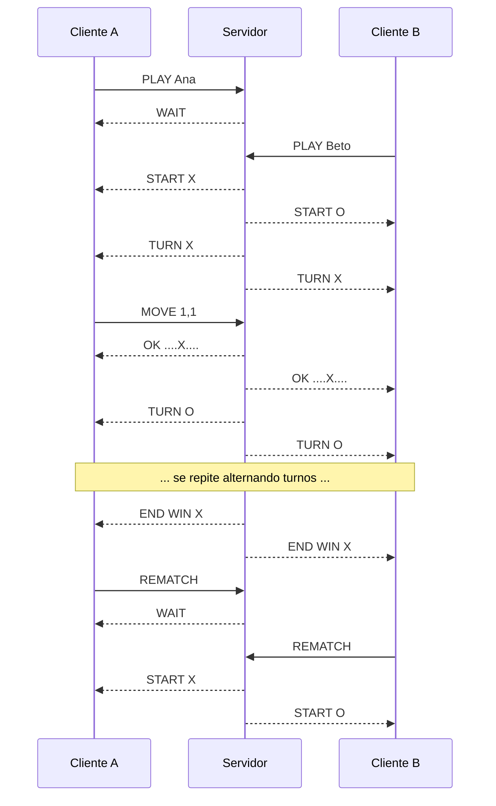
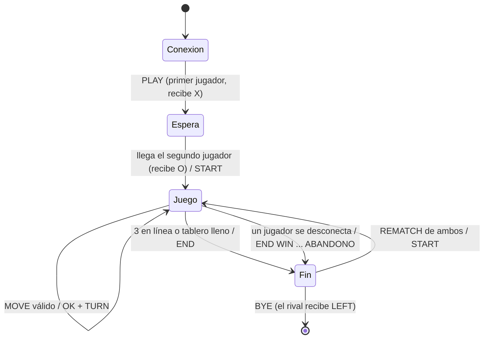

# Tres en raya online (Java, cliente-servidor TCP)

Juego del tres en raya para dos jugadores remotos. Un **servidor** actúa de árbitro (valida jugadas, controla turnos y declara el resultado) y dos **clientes** de consola se conectan por TCP.

- Lenguaje: Java 17 o superior (usa `switch` con flechas).
- Sin dependencias externas.
- Una única partida simultánea de dos jugadores.

## Estructura

```
src/
├── common/Protocolo.java          # Constantes del protocolo (compartidas)
├── server/
│   ├── Servidor.java              # main: acepta conexiones, un hilo por cliente
│   ├── ManejadorJugador.java      # lee los comandos de un cliente
│   ├── Partida.java               # estado de la partida (monitor synchronized)
│   ├── Tablero.java               # lógica pura del tablero 3x3
│   └── Jugador.java               # nombre, marca y canal de salida
└── client/
    ├── Cliente.java               # main: conexión, hilo receptor, teclado
    └── TableroConsola.java        # dibuja el tablero en consola
docs/memoria.md                    # borrador de la memoria (máx. 4 páginas)
```

## Compilar y ejecutar

Desde la raíz del proyecto:

```bash
# Compilar
javac -d out src/common/*.java src/server/*.java src/client/*.java

# Servidor (puerto opcional, por defecto 5050)
java -cp out server.Servidor [puerto]

# Cliente (host, puerto y nombre opcionales)
java -cp out client.Cliente [host] [puerto] [nombre]
```

En Windows, si `src/common/*.java` no se expande, lista los ficheros a mano o usa `dir /s /b src\*.java > fuentes.txt` y `javac -d out @fuentes.txt`.

Para la demo en máquinas distintas: arranca el servidor en una, averigua su IP (`ipconfig` / `ip a`) y en la otra ejecuta `java -cp out client.Cliente <IP-del-servidor> 5050 Ana`. Abre el puerto 5050 en el cortafuegos si hace falta.

**Cómo se juega:** escribe `fila columna` (de 0 a 2, por ejemplo `1 1`), `r` para pedir revancha al terminar, `q` para salir.

---

## Protocolo de comunicación

### Formato

- Protocolo **textual**, codificación UTF-8.
- Cada mensaje es **una línea** terminada en salto de línea: `COMANDO [argumentos]`.
- Los comandos van en mayúsculas; los argumentos se separan con un espacio.
- Casillas: `fila,columna` con valores de **0 a 2**, sin espacios (`MOVE 1,2`).
- Tablero: cadena de **9 caracteres** leída fila a fila: `X` , `O` o `.` (casilla vacía). Ejemplo: `X.O..X...`

```
 X . O      posiciones 0 1 2   -> fila 0
 . . X      posiciones 3 4 5   -> fila 1
 . . .      posiciones 6 7 8   -> fila 2
```

### Mensajes Cliente → Servidor

| Comando | Argumentos | Descripción |
|---|---|---|
| `PLAY` | `<nombre>` | Pide entrar a la partida. Debe ser el primer mensaje de la conexión. |
| `MOVE` | `<fila,col>` | Quiere marcar esa casilla. |
| `REMATCH` | - | Pide revancha (solo válido cuando la partida ha terminado). |
| `BYE` | - | Desconexión voluntaria. |

### Mensajes Servidor → Cliente

| Comando | Argumentos | Descripción |
|---|---|---|
| `WAIT` | - | Estás en espera: falta el segundo jugador (o el rival aún no ha aceptado la revancha). |
| `START` | `<X\|O>` | La partida empieza y esta es tu marca. |
| `TURN` | `<X\|O>` | De quién es el turno. Se envía a **ambos** jugadores. |
| `OK` | `<tablero>` | Movimiento aceptado; tablero actualizado. Se envía a **ambos**. |
| `DENIED` | `<motivo>` | Comando o movimiento rechazado. Solo al emisor. |
| `END` | `WIN <X\|O>` · `DRAW` · `WIN <X\|O> ABANDONO` | Fin de la partida. Se envía a ambos (salvo abandono: solo al que queda). |
| `FULL` | `<texto>` | La partida ya tiene dos jugadores; se cierra la conexión. |
| `LEFT` | - | El rival se ha ido cuando la partida ya había terminado; se cierra la conexión. |

### Motivos de `DENIED`

| Texto | Cuándo |
|---|---|
| `no es tu turno` | `MOVE` de quien no tiene el turno. |
| `casilla ocupada` | La casilla ya tiene marca. |
| `fuera del tablero` | Fila o columna fuera de 0–2. |
| `formato invalido, usa MOVE fila,col` | El argumento no se puede interpretar. |
| `partida terminada` | `MOVE` después de `END`. |
| `esperando al rival` | `MOVE` con un solo jugador conectado. |
| `la revancha solo se pide al terminar la partida` | `REMATCH` en mitad de una partida. |
| `se esperaba PLAY <nombre>` | El primer mensaje no fue un `PLAY` válido. |
| `comando desconocido` | Comando no reconocido. |

### Flujo de una partida



### Estados y reglas



- El primer jugador recibe `X` y empieza siempre. El segundo recibe `O`.
- Un tercer cliente recibe `FULL Partida llena` y se cierra su conexión.
- El servidor solo acepta `MOVE` del jugador que tiene el turno.
- Si un jugador se desconecta **a mitad de partida**, el otro recibe `END WIN <su marca> ABANDONO` y se cierra su conexión.
- Si un jugador envía `BYE` (o se cae) **cuando la partida ya había terminado**, el rival recibe `LEFT` y se cierra su conexión.
- Cuando ya no queda nadie, la partida se reinicia y admite dos jugadores nuevos.

### Cambios respecto a la propuesta del enunciado (justificación)

| Cambio | Motivo |
|---|---|
| Se añade `LEFT` | La propuesta no cubre que un jugador se vaya *después* del fin de partida; el rival necesita saber que la revancha ya no es posible. |
| `END` admite `ABANDONO` como tercer argumento | Distinguir una victoria normal de una por abandono sin crear otro comando. |
| `WAIT` también se usa tras `REMATCH` | Reutilizar un mensaje ya existente para «estás esperando al rival» en vez de añadir otro. |
| `FULL` lleva texto (`Partida llena`) | El enunciado pide un mensaje de error al tercer cliente. |
| `DENIED` también cubre errores de registro y de formato | Un único mensaje de error para el cliente; el motivo va en texto. |
| Casillas de 0 a 2 | Coincide con los índices del array; la capa de interfaz puede mostrar 1–3 si se desea. |

---

## Decisiones de concurrencia (resumen)

- **Un hilo por conexión** en el servidor (`ManejadorJugador`): cada cliente bloquea en `readLine()` sin afectar al otro.
- **`Partida` es un monitor**: todos sus métodos públicos son `synchronized`. Así dos `MOVE` simultáneos se procesan uno detrás de otro y el turno nunca se corrompe.
- **El servidor es la única fuente de verdad**: el cliente no valida turnos, solo muestra lo que el servidor le dice.
- **El cliente usa dos hilos**: uno escucha al servidor y otro atiende el teclado, para recibir el movimiento del rival mientras se espera la entrada del usuario.
- **Cierre de recursos**: `try-with-resources` en el servidor y `finally` que llama a `Partida.desconectar(...)`, que es idempotente.

## Reparto de trabajo y ramas

Consulta `GUIA_REPARTO.md` (flujo de ramas, commits de cada persona y pull requests).